# Design Canvas Vault — Visual Gallery & Lookbook

Welcome to the visual gallery of **Design Canvas Vault** (1,245 templates, 79 business demo design systems, and ready-to-use UI components).

---

## 79 Business Niche Design Systems (Palettes & Fonts)

| Industry               | Demo ID            | Primary Color | Secondary Color | Typography                    |
| ---------------------- | ------------------ | ------------- | --------------- | ----------------------------- |
| **Fintech / Finance**  | `demo-finance`     | `#264653`     | `#E9C46A`       | DM Serif Text / Manrope       |
| **SaaS Modern**        | `demo-saas`        | `#0b44a7`     | `#ffbd00`       | Hoss Round / Sans-serif       |
| **Medical & Health**   | `demo-medical`     | `#0088cc`     | `#2C3E50`       | Poppins / Sans-serif          |
| **Real Estate**        | `demo-real-estate` | `#1ABC9C`     | `#333333`       | Lato / Sans-serif             |
| **Restaurant / Food**  | `demo-restaurant`  | `#d35400`     | `#2C3E50`       | Playfair Display / Sans-serif |
| **Gym & Fitness**      | `demo-gym`         | `#e74c3c`     | `#111111`       | Montserrat / Sans-serif       |
| **Law Firm / Legal**   | `demo-law-firm`    | `#1d2a44`     | `#c5a880`       | Merriweather / Sans-serif     |
| **Agency Modern**      | `demo-agency`      | `#222222`     | `#1ABC9C`       | Poppins / Sans-serif          |
| **App Landing**        | `demo-app-landing` | `#445165`     | `#59ba47`       | Poppins / Sans-serif          |
| **E-Commerce Minimal** | `demo-ecommerce`   | `#000000`     | `#c5a880`       | Montserrat / Sans-serif       |

_Browse all 79 industries in [`catalog/01-demos-dna.md`](catalog/01-demos-dna.md)._

---

## Featured UI Blocks

| ID                           | Name         | Category  | Thumbnail                                                |
| ---------------------------- | ------------ | --------- | -------------------------------------------------------- |
| `block-hero-1`               | Hero 1       | `hero`    |              |
| `block-hero-2`               | Hero 2       | `hero`    |              |
| `block-hero-3`               | Hero 3       | `hero`    | 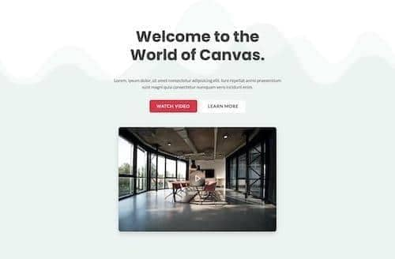             |
| `block-hero-4`               | Hero 4       | `hero`    | 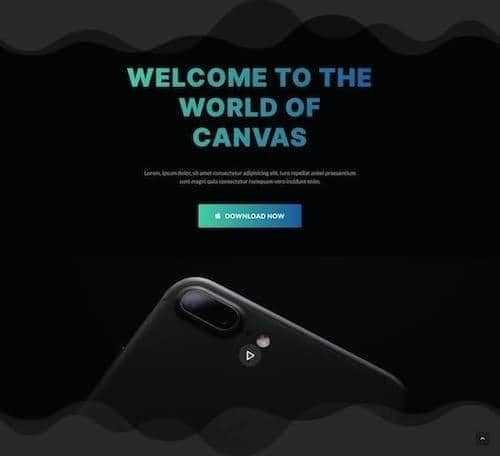             |
| `block-hero-5`               | Hero 5       | `hero`    | 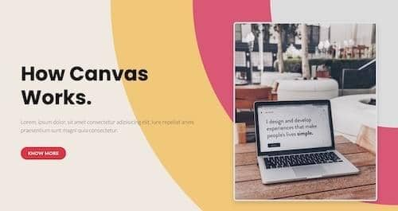             |
| `block-hero-6`               | Hero 6       | `hero`    | 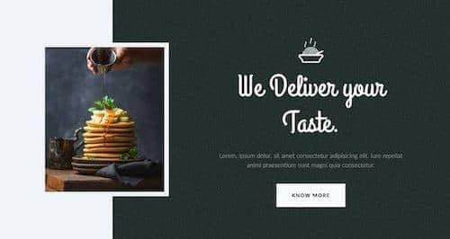             |
| `block-hero-7`               | Hero 7       | `hero`    |              |
| `block-hero-10`              | Hero 10      | `hero`    |            |
| `block-content-cards-1`      | Cards 1      | `cards`   | 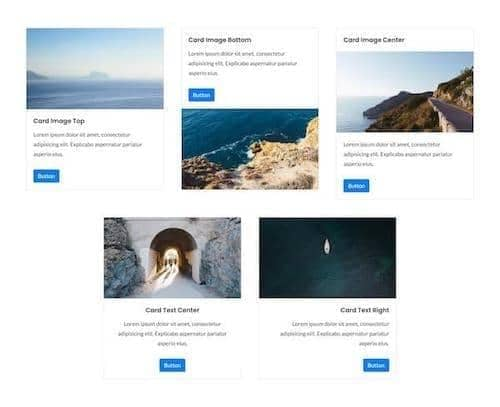           |
| `block-content-cards-2`      | Cards 2      | `cards`   | 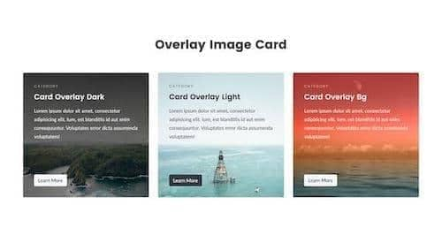           |
| `block-content-cards-switch` | Cards Switch | `cards`   | 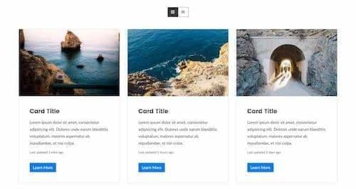 |
| `block-content-pricing-1`    | Pricing 1    | `pricing` | 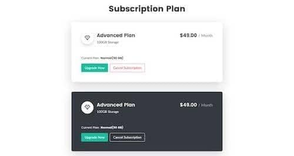       |
| `block-content-pricing-5`    | Pricing 5    | `pricing` | 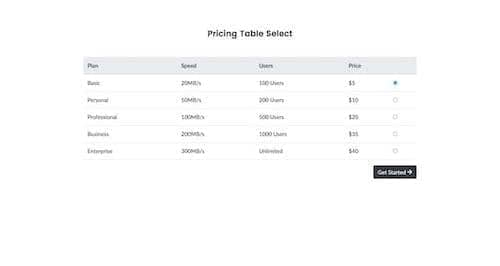       |
| `block-content-pricing-11`   | Pricing 11   | `pricing` | 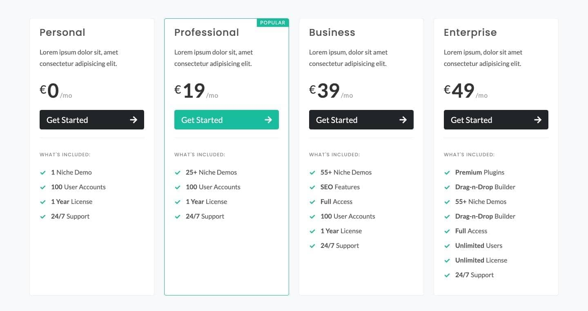     |
| `block-form-1`               | Form 1       | `forms`   | 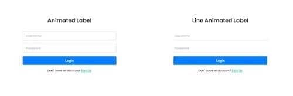             |
| `block-footer-1`             | Footer 1     | `footers` | 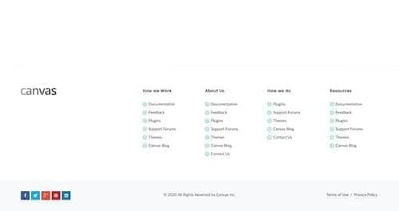         |
| `block-footer-4`             | Footer 4     | `footers` | 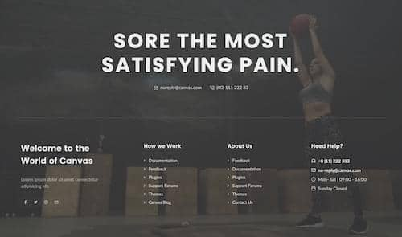         |

Explore the full catalog in [`catalog/02-blocks-catalog.md`](catalog/02-blocks-catalog.md) or start the visual interface with `npm start`.
